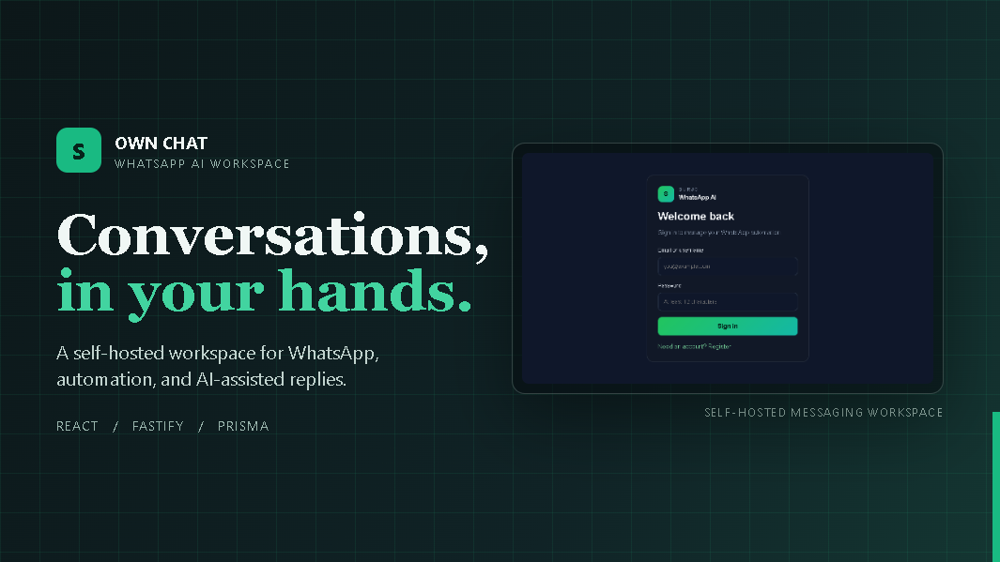
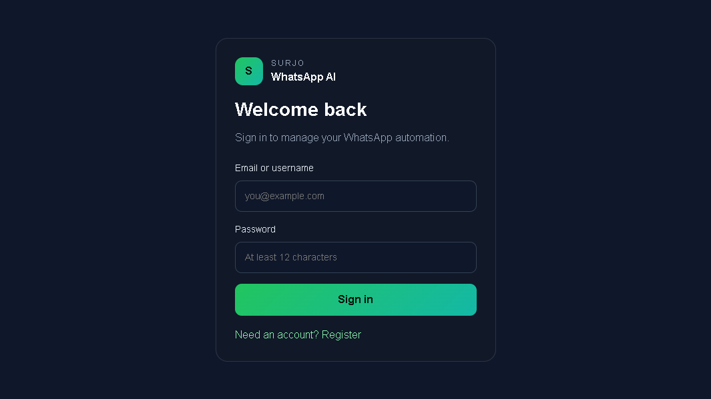

# SURJO WHATSAPP AI

This repository contains a local, multi-tenant WhatsApp AI platform scaffold built with Fastify, React, Vite, Prisma, and Redis-friendly worker architecture. The project is designed for local Windows hosting and includes backend APIs, UI shell, security primitives, and operational scripts.

## Project cover



## Sign-in preview



## Quick start

### One-command Windows setup

Run this from the project root:

```bat
setup.bat
```

This script will:
- check for Windows 10/11 and required dependencies
- install missing Node.js and Python tools when possible
- configure `.env` if it is missing
- install PostgreSQL and Redis when they are missing
- start the required services
- run Prisma generation and migrations
- start the backend and frontend
- open the dashboard automatically

### Manual start

1. Copy `.env.example` to `.env` and adjust the values.
2. Start PostgreSQL and Redis using Docker Compose from `infra/docker-compose.yml` or local Windows services.
3. Run `pnpm install`.
4. Run `pnpm db:generate` and `pnpm db:migrate`.
5. Run `pnpm --dir apps/server dev` and `pnpm --dir apps/dashboard dev`.

## Structure

- `apps/server`: Fastify backend
- `apps/dashboard`: React dashboard UI
- `packages/shared`: shared types and validation models
- `packages/security`: encryption and password helpers
- `packages/database`: Prisma schema and migrations
- `scripts`: Windows PowerShell automation
- `docs`: documentation and installation guides

## Important notes

- The project is designed for local, private Windows deployment.
- WhatsApp QR flows and remote AI connectivity require the owner to authorize their own device and provide valid credentials.
- Secrets must never be stored in the browser or committed to Git.
